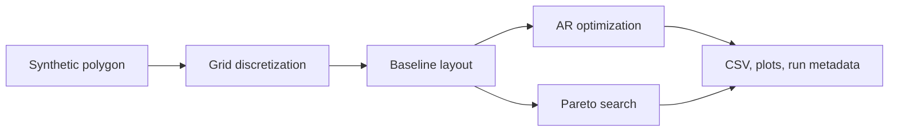

# campOS

**A research prototype for sprinkler-layout optimization on synthetic lawn geometries.**

[](https://github.com/HaochuanLin/campOS/actions/workflows/tests.yml)
[](https://www.python.org/)
[](LICENSE)

> **Important:** campOS is not field-validated. Lawn geometry is synthetic, sprinkler physics and economic inputs include placeholders, and outputs must not be treated as installation instructions or guaranteed water savings.

campOS compares four search modes for rotary-sprinkler layouts:

- **Movable-head optimization:** sprinkler positions, throw radii, and sector angles may change.
- **Fixed-position retrofit optimization:** sprinkler coordinates remain unchanged; only radii and sector angles may change.
- **Pareto search:** explores the trade-off between overspray and interior water deficit, with a dry-area constraint.

## Quick start

Requires Python 3.10 or newer.

```bash
git clone https://github.com/HaochuanLin/campOS.git
cd campOS
python -m pip install -r requirements.txt
python campos_sim.py --help
```

Run a short smoke test on one synthetic rectangular site:

```bash
python campos_sim.py --mode movable --quick --sites A --outdir out/demo
```

The command writes CSV summaries, PNG plots, and `run_metadata.json` to `out/demo/`. The metadata records the selected modes and sites, effective model configuration, Python/platform details, NumPy/Matplotlib versions, and a SHA-256 hash of the simulation source.

For a single-objective run, the main artifacts are `results_<mode>.csv`, `layouts_<mode>.png`, and `ranking_<mode>.png`. Pareto runs write `pareto_<fixed|movable>.csv` and `pareto_<fixed|movable>.png`. When both single-objective modes run together, a `comparison_single_objective.csv` is also written.

More examples:

```bash
# Fixed-position retrofit mode
python campos_sim.py --mode fixed --sites A C --outdir out/fixed

# Pareto trade-off for the synthetic kidney-shaped site
python campos_sim.py --mode pareto-fixed --quick --sites C --outdir out/pareto

# All four modes across all five synthetic sites (computationally expensive)
python campos_sim.py --mode all --outdir out/full
```

`--quick` reduces optimization iterations for smoke testing. It is not a substitute for a full run. Generated output is ignored by Git by default; publish results only after reviewing the CSVs, metadata, and figures.

## Optimization modes

| Mode | Parameters allowed to change | Purpose |
|---|---|---|
| `movable` | Position `x/y`, radius `r`, start angle `a0`, arc width `w` | Explore a new layout using the legacy AR objective |
| `fixed` | Radius `r`, start angle `a0`, arc width `w`; `x/y` fixed | Explore a retrofit without relocating heads |
| `pareto-movable` | Position, radius, start angle, arc width | Explore overspray/deficit trade-offs with movable heads |
| `pareto-fixed` | Radius, start angle, arc width; `x/y` fixed | Explore retrofit trade-offs without relocating heads |

The built-in synthetic sites are **A** rectangle, **B** L-shape, **C** kidney, **D** wedge, and **E** roadside strip. They are generated polygons, not surveyed properties.



## Metrics: read them carefully

The model reports several metrics that answer different questions. They are not interchangeable.

- **AR (legacy single-objective metric):** total modelled applied water divided by the product of lawn-cell count and the mean depth of the driest quarter of lawn cells. Lower is better for this objective.
- **AR-based saving metric:** `1 - AR_optimized / AR_baseline`. This is **not a measured or direct reduction in total water use**. It estimates a change in the low-quarter scheduling metric; optimized total discharge may increase.
- **Overspray (`f1`):** in Pareto mode, water outside the lawn divided by the baseline layout's total modelled water. The separate legacy overspray metric is the outside-water share of that layout's own total water. These denominators differ.
- **Interior deficit (`f2`):** average relative shortfall below a target depth over lawn cells. The target is a configurable multiple of the baseline mean lawn depth.
- **Dry-area fraction:** share of lawn cells below a configured fraction of the target depth. Pareto candidates must satisfy the configured limit to enter the archive.
- **CU:** a Christiansen-style uniformity metric reported for interpretation; it is not the Pareto search's primary objective.

The standard-grid baseline and the full-circle reference are different comparisons. The full-circle layout is a deliberately naive reference, not a measured existing installation. The project brief reported low baseline overspray (approximately 0–1%) but edge dry patches (5.6–8.1%) for the standard-grid/preset-arc baseline; it did **not** establish an overspray reduction against that baseline.

See [the model definition and limitations](docs/MODEL.md) for formulas and assumptions.

## Preliminary figures from the project brief

The following values were supplied in the project brief, but the original result CSVs and run configuration were not available for independent verification in this repository. They are **unverified synthetic-model outputs using placeholder assumptions**, not field measurements.

| Mode | Synthetic shape | AR-based metric | Placeholder payback period |
|---|---|---:|---:|
| Fixed position | Kidney | 35.3% | 12.1 years |
| Fixed position | L-shape | 25.5% | 22.6 years |
| Movable | Kidney | 38.0% | 65.5 years |
| Movable | L-shape | 24.0% | 137.1 years |

Reported comparison against the **full-circle reference only**:

| Synthetic shape | Overspray | Interior deficit |
|---|---:|---:|
| Kidney | 21% → 14% | 6.8% → 0.9% |
| Roadside strip | 54% → 11.6% | 6.6% → 1.1% |

No result figures are published yet because the source result files were not included. Do not treat the numbers above as reproduced results until the corresponding CSVs, run metadata, and plots are published and checked.

## Assumptions and limitations

- All lawn boundaries are synthetic; there is no real-site survey or field validation.
- The radial precipitation profile and throw range are stylized placeholders, not manufacturer specifications.
- Water tariffs, annual irrigation depth, and retrofit costs are placeholders, not verified prices.
- Wind, pressure loss, evaporation, drift, slope, and soil effects are not modelled.
- Water depth is represented in relative model units, not litres.
- Grid-based polygon coverage is approximate and depends on the configured cell size.
- There is no calibrated manufacturer profile, lifecycle-cost analysis, uncertainty study, or operational safety assessment.

Use campOS for exploratory comparisons and method development only—not for construction, irrigation scheduling, procurement, or savings claims.

## Development and tests

Install the development dependencies and run the test suite:

```bash
python -m pip install -e ".[dev]"
python -m pytest -q
```

Tests cover fixed-position coordinate invariance, cache correctness across configurations, Pareto archive behavior, and output generation. GitHub Actions runs the suite on Python 3.10, 3.11, and 3.12 for pushes and pull requests.

## Project structure

```text
campos_sim.py                 CLI launcher
src/campos/campos_sim.py      Simulation implementation
tests/                        Regression and smoke tests
docs/MODEL.md                 Metrics, assumptions, and limitations
docs/RELEASE_NOTES_v0.1.0.md  Initial prototype notes
examples/                     Reproducible example commands
results/                      Curated results only; no generated files committed by default
```

## Roadmap

- [ ] Publish reviewed CSV outputs, run metadata, and figures for selected synthetic cases.
- [ ] Add input validation and support for imported lawn polygons.
- [ ] Replace placeholder sprinkler profiles with manufacturer catch-can/precipitation data.
- [ ] Add sensitivity and uncertainty analysis for wind, pressure, and model parameters.
- [ ] Validate against measured sites using a documented protocol and appropriate permission.
- [ ] Add benchmark cases and broader regression tests before changing optimization logic.

## Citation

If you use campOS in research, cite the repository and the specific version or commit you used. See [CITATION.cff](CITATION.cff). No DOI has been assigned.

## License

Released under the MIT License; see [LICENSE](LICENSE). Confirm code ownership and third-party license compatibility before making a formal release.
