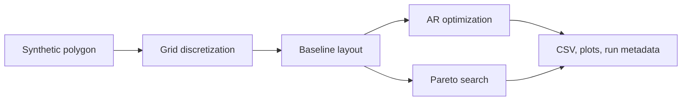

# campOS

**A research prototype for sprinkler-layout optimization on synthetic lawn geometries.**

[](https://github.com/HaochuanLin/campOS/actions/workflows/tests.yml)
[](https://www.python.org/)
[](LICENSE)

> **Important:** campOS is not field-validated. Lawn geometry is synthetic, sprinkler physics and economic inputs include placeholders, and outputs must not be treated as installation instructions or guaranteed water savings.

## Project concept

campOS is an **open, reproducible decision-support prototype for comparing sprinkler-layout options on irregular lawns**. It is designed to make a design question inspectable: given a lawn boundary and an existing or proposed sprinkler layout, how do alternative configurations trade water applied outside the lawn against the modelled risk of insufficient coverage inside it?

It is not an autonomous irrigation controller, a certified engineering design tool, or a water-savings calculator. Its purpose at this stage is to compare candidate layouts under explicit assumptions, expose the trade-offs behind each result, and provide a disciplined path from synthetic experiments to measurement-based evaluation.

### The workflow

1. **Describe the site:** use a synthetic test shape or import a measured lawn boundary and existing head coordinates.
2. **Establish a baseline:** record the input geometry, layout, model assumptions, grid resolution, and random seed.
3. **Explore alternatives:** compare fixed-position retrofit and movable-head search; use Pareto modes when overspray and interior deficit must be considered together.
4. **Inspect evidence:** review the metrics, plots, raw CSVs, run metadata, and matched-scenario reports—not a single headline score alone.
5. **Validate before relying on it:** calibrate inputs with documented sprinkler data and evaluate predictions against independent observations before making real-site or savings claims.

### What the current prototype can and cannot support

- **Can support now:** reproducible synthetic comparisons, exploratory layout search, sensitivity checks, input provenance, and transparent reporting of model-defined metrics.
- **Can support with appropriate user data:** geometry-specific comparisons and model calibration workflows, provided the supplied data are documented and their limits are respected.
- **Cannot yet support:** validated installation recommendations, guaranteed water savings, payback estimates, or claims of field accuracy. The built-in lawn shapes are synthetic; wind, drift, evaporation, pressure losses, soil response, and other site effects are not fully modelled.

See [the project charter](docs/PROJECT_CHARTER.md) for the intended scope, evidence standards, and development priorities. For a practical measurement plan, required field records, and the distinction between calibration and independent evaluation, see the [real-site validation protocol](docs/REAL_SITE_VALIDATION_PROTOCOL.md).

Copy the empty [field observation template](data/templates/field_catch_can_template.csv), fill one row per can per run, and keep the raw copy unchanged. Before any model comparison, run the field-observation data-quality checker on the completed CSV:

```bash
cp data/templates/field_catch_can_template.csv data/field_catch_can_observations.csv
# Edit data/field_catch_can_observations.csv, then run:
campos-observation-qc \
  --input data/field_catch_can_observations.csv \
  --outdir out/field-data-qc
```

It checks required columns, unique can IDs per site/run, numeric values, units, zone labels, and calibration/holdout split consistency; if depth is blank, it derives depth in mm from collected volume and opening area. The normalized CSV preserves available pressure and weather fields and the JSON summary records quality warnings. This is **data QC only**—it does not compare observations with model predictions or count as field validation. For an end-to-end comparison, `scripts/predict_catch_can_depths.py` evaluates the sprinkler field at exact catch-can coordinates using a supplied polygon, sprinkler layout, measured flow per head, and filled observations CSV. It writes paired predictions and calibration/holdout metrics; see the [real-site validation protocol](docs/REAL_SITE_VALIDATION_PROTOCOL.md) for the command, required inputs, and limits. After installing the package, the same workflow is available as `campos-field-evaluate` without invoking the script path. The standalone `scripts/evaluate_observation_errors.py` remains available for scoring already-paired values.

## Quick start

Requires Python 3.10 or newer.

```bash
git clone https://github.com/HaochuanLin/campOS.git
cd campOS
python -m pip install -e ".[dev]"
campos-sim --help
campos-field-evaluate --help
campos-observation-qc --help
campos-field-report --help
python -m pytest -q
```

### Run a short synthetic simulation

```bash
python campos_sim.py --mode movable --quick --sites A --outdir out/demo
```

This is a software smoke test, not a real-site design. The command writes CSV summaries, PNG plots, and `run_metadata.json` to `out/demo/`.

### Compare overspray against interior coverage

For the project's central trade-off, start with a Pareto run. The fixed-position mode is useful for retrofit studies where head locations cannot be moved:

```bash
# Quick software smoke test only
python campos_sim.py --mode pareto-fixed --quick --sites C --outdir out/pareto-smoke

# More thorough synthetic exploration
python campos_sim.py --mode pareto-fixed --sites C --outdir out/pareto
```

The Pareto modes explore the trade-off between modelled water outside the lawn and interior depth deficit, subject to the configured dry-area constraint. The search is stochastic and approximate; review the CSV, metadata, and plots rather than treating one selected point as a guaranteed optimum.

The displayed trade-off is guarded against silent regressions: a selected Pareto point must stay within the baseline-relative CU-loss budget, respect the configured overspray tolerance, keep mean interior deficit no worse than baseline, and satisfy the configured dry-area limit. If no point satisfies every guardrail, the run reports no selected point and records which constraints rejected candidates in the Pareto CSV and matched benchmark summary. If you deliberately want to permit a bounded increase in the active f1 objective to improve interior coverage, set `--max-overspray-increase 0.01` to allow up to 1 percentage point of baseline total modelled water as additional objective water. Without a protected-surface polygon, f1 is all outside-lawn water; with `--protected-surface-csv`, f1 is water on that polygon. This is an explicit modelling trade-off, not a water-savings claim. The default is `0` (no increase in the active f1 objective).

**Objective boundary and optional protected-surface mask:** by default, Pareto f1 counts all modelled water outside the lawn polygon; it does not distinguish roads/sidewalks from garden beds or drains. For a measured custom site, pass `--protected-surface-csv` with a separate surveyed road/sidewalk polygon CSV (`x_m,y_m` columns, metres) to make f1 count modelled water on that polygon. CSV output reports outside-lawn water and protected-surface water separately. The protected polygon may share a boundary with the lawn but must not overlap its interior. The mask uses cell-centre inclusion at the configured grid resolution, so inspect grid-resolution sensitivity. This is a geometry-specific simulated proxy—not observed spray drift, runoff, or field validation.

Before interpreting a protected-surface objective, quantify geometric rasterization error across grid sizes:

```bash
python scripts/check_protected_surface_resolution.py \
  --polygon-csv data/site_polygon.csv \
  --protected-surface-csv data/sidewalk_polygon.csv \
  --heads-csv data/sprinkler_layout.csv \
  --cell-sizes 2,1,0.5,0.25 \
  --max-relative-error 0.05 \
  --out out/protected-surface-resolution.csv
```

The optional `--heads-csv` evaluates one unchanged sprinkler layout at each resolution and reports the modelled water share reaching the protected polygon. The area-error threshold applies only to polygon area; water-share variation still needs review and does not establish field performance. See [custom-site and resolution-check documentation](docs/CUSTOM_SITE_INPUTS.md).

### Run the included field-evaluation example

```bash
campos-field-evaluate \
  --polygon-csv examples/field_evaluation_demo/site_polygon.csv \
  --heads-csv examples/field_evaluation_demo/sprinkler_layout.csv \
  --observations examples/field_evaluation_demo/catch_can_observations.csv \
  --outdir out/field-evaluation-demo
```

This example is **synthetic software smoke-test data only**, not field evidence or a calibration dataset. Read [the example notes](examples/field_evaluation_demo/README.md) before adapting the workflow to real measurements. The field-evaluation command uses measured per-head `flow_lpm` values in the layout CSV; if any are blank, pass `--flow-lpm` as a fallback.

### Build a shareable field-evaluation report

After running `campos-field-evaluate`, create HTML and Markdown summaries from its metrics JSON:

```bash
campos-field-report --input-json out/field-evaluation-demo/field_evaluation_metrics.json
```

The report includes overall and zone-stratified errors, input hashes, geometry/zone-label warnings, and model limitations. It does not issue a pass/fail certification.

### Import a measured site polygon and existing sprinkler positions

Custom input CSVs use metre-based coordinates. See the [input format and limitations](docs/CUSTOM_SITE_INPUTS.md); starter templates are in `data/templates/`.

```bash
python campos_sim.py --mode fixed --quick \
  --polygon-csv data/templates/site_polygon_template.csv \
  --heads-csv data/templates/sprinkler_layout_template.csv \
  --outdir out/custom-site
python scripts/build_design_report.py --input-dir out/custom-site
```

The checked-in coordinate templates are illustrative only, not surveyed measurements or installation recommendations. For field observations, fill the empty [catch-can template](data/templates/field_catch_can_template.csv), record calibration/holdout splits by whole run, and follow the [real-site validation protocol](docs/REAL_SITE_VALIDATION_PROTOCOL.md). Replace all example geometry, layout, and observation data with documented site measurements before field evaluation.

### Generate a shareable report

```bash
python scripts/build_design_report.py --input-dir out/demo
```

This creates a self-contained `design_report.html` and `design_report.md`. The report summarizes the run; it does not convert AR changes into water savings or certify a real-site layout.

## Model inputs and physics references

campOS compares four search modes for rotary-sprinkler layouts:

- **Movable-head optimization:** sprinkler positions, throw radii, and sector angles may change.
- **Fixed-position retrofit optimization:** sprinkler coordinates remain unchanged; only radii and sector angles may change.
- **Pareto search:** explores the trade-off between overspray and interior water deficit, with a dry-area constraint.

### Use a measured sprinkler radial profile

If you have catch-can measurements for the actual nozzle and operating pressure, provide a CSV with `radius_fraction,relative_rate` columns and run:

```bash
# With measured catch-can data
python campos_sim.py --mode movable --quick --sites A --profile-csv data/catch_can_profile.csv --outdir out/profile-run

# Without measurements: compare alternative assumed radial shapes
python campos_sim.py --mode movable --quick --sites A --radial-slope -0.5 --outdir out/sensitivity-center-heavy
python campos_sim.py --mode movable --quick --sites A --radial-slope 0 --outdir out/sensitivity-uniform
python campos_sim.py --mode movable --quick --sites A --radial-slope 1 --outdir out/sensitivity-edge-heavy
```

For raw catch-can observations, use `scripts/prepare_radial_profile.py` to convert repeated depth readings into the loader's profile format. The measurement checklist, required raw CSV columns, endpoint assumptions, and validation limits are documented in [the radial-profile protocol](docs/RADIAL_PROFILE_PROTOCOL.md). The checked-in [CSV template](data/templates/catch_can_observations_template.csv) is intentionally empty and is not a dataset.

The profile is area-normalized and changes the radial distribution shape. It does **not** supply absolute flow or validate the model by itself. If you have no catch-can data, use the default uniform-depth null model and compare sensitivity scenarios with `--radial-slope` (valid values are greater than -1):

### Optional measured pressure-performance curve

For a specific sprinkler, provide a measured table with `pressure_kpa,flow_lpm,throw_m` and choose a pressure within the table's measured range:

```bash
python campos_sim.py --mode fixed --quick --sites A --profile-csv data/catch_can_profile.csv --performance-csv data/performance.csv --pressure-kpa 250 --outdir out/calibrated
```

This is an invocation example, not a recommended pressure setting. The performance table must come from the actual sprinkler/nozzle or a documented test. When active, the model uses interpolated flow and throw and locks throw radius during optimization. The absolute field is an estimated precipitation rate in mm/h under uniform-sector assumptions, not field validation.

### Public sprinkler-physics benchmark

I added a reproducible check against published Rain Bird 5000 Series standard-angle nozzle data:

```bash
python scripts/benchmark_sprinkler_curve.py
```

The six-point CSV includes pressure, flow, throw radius, and manufacturer-published square/triangular precipitation rates. The benchmark compares those rates with a flow / grid-cell-area calculation using the chart's half-circle operating assumption. A 1 mm/h tolerance accounts for integer rounding. This is a public manufacturer-chart consistency check, **not independent field validation** and not a measurement of the local radial spray pattern. Source and transcription details are in [data/benchmarks/README.md](data/benchmarks/README.md).

The same file is a runnable example of the pressure-performance option at 200–450 kPa:

```bash
python campos_sim.py --mode fixed --quick --sites A --performance-csv data/benchmarks/rainbird_5000_standard_1_5.csv --pressure-kpa 300 --outdir out/rainbird-example
```

Without a measured catch-can profile for this exact nozzle/pressure, the radial field remains a placeholder; do not interpret this example as a field-validated layout.

## Optimization modes

| Mode | Parameters allowed to change | Purpose |
|---|---|---|
| `movable` | Position `x/y`, radius `r`, start angle `a0`, arc width `w` | Explore a new layout using the legacy AR objective |
| `fixed` | Radius `r`, start angle `a0`, arc width `w`; `x/y` fixed | Explore a retrofit without relocating heads |
| `pareto-movable` | Position, radius, start angle, arc width | Explore overspray/deficit trade-offs with movable heads |
| `pareto-fixed` | Radius, start angle, arc width; `x/y` fixed | Explore retrofit trade-offs without relocating heads |

The built-in synthetic sites are **A** rectangle, **B** L-shape, **C** kidney, **D** wedge, and **E** roadside strip. They are generated polygons, not surveyed properties.

### Explicit optimization policy

The legacy `movable` and `fixed` modes remain available as a comparison baseline. Use `pareto-movable` or `pareto-fixed` when you want to examine the trade-off between overspray and interior deficit instead of optimizing AR alone.

The Pareto policy can be set explicitly and is recorded in `run_metadata.json`:

```bash
python campos_sim.py --mode pareto-fixed --quick --sites C \
  --dry-fraction-limit 0.02 \
  --target-factor 1.0 \
  --cu-drop-budget 0.03 \
  --pareto-weights 0,0.25,0.5,0.75,1 \
  --outdir out/pareto-policy
```

- `--dry-fraction-limit`: maximum fraction of lawn cells allowed below the configured dry threshold. This is a model constraint, not a plant-health guarantee.
- `--target-factor`: target depth as a multiple of the baseline lawn mean. The default of 1.0 is a comparison convention, not an agronomic prescription.
- `--cu-drop-budget`: maximum absolute CU loss allowed relative to baseline CU when selecting the displayed trade-off.
- `--max-overspray-increase`: maximum allowed increase in Pareto f1 relative to baseline, as a fraction of baseline total modelled water. The default `0` forbids overspray regression; `0.01` permits up to one percentage point of baseline total water as additional outside-lawn water.
- `--pareto-weights`: weights used to guide stochastic exploration toward different parts of the Pareto front. They are search controls, not evidence-based utility weights; the final selected point must meet the baseline-relative CU budget and overspray-increase tolerance and must not worsen interior deficit.

These settings make assumptions explicit; they do not make the model field-validated. Compare several settings and report the full trade-off before treating any one selection as a preferred design.



## Matched optimization benchmark

Run the legacy AR modes and Pareto modes against the same synthetic site, seed, grid, radial field, and baseline layout:

```bash
python scripts/compare_optimization_modes.py --quick --sites A
```

By default, the script compares all five synthetic sites; omit `--quick` for the configured full optimization iterations. It writes `benchmark_summary.csv`, a concise `README.md` report, and the raw simulation CSVs, plots, metadata, and console log under `out/optimization-benchmark/`. Set `--seed`, `--cell-size`, `--radial-slope`, `--dry-fraction-limit`, `--target-factor`, `--cu-drop-budget`, `--max-overspray-increase`, and `--pareto-weights` to reproduce or vary assumptions.

The comparison is matched at the scenario/configuration level, but the algorithms optimize different objective functions and Pareto search is a stochastic finite-search approximation. Pareto f1 and legacy overspray share different denominators; Pareto and legacy dry-area metrics also use different thresholds. The benchmark therefore reports both objective-specific and shared metrics instead of collapsing them into a single winner score. It is a synthetic model comparison, not field validation or a water-savings estimate.


## JSON configuration and matched design comparisons

Run a reproducible configuration file (CLI flags override JSON values):

```bash
python campos_sim.py --config configs/run.example.json
```

Compare named scenarios while keeping geometry, seed, grid, radial assumptions, and measurement files fixed:

```bash
python scripts/compare_design_configs.py \
  --spec configs/design_comparison.example.json \
  --outdir out/design-comparison
```

The script writes `design_comparison.csv`, `comparison_manifest.json`, a Markdown summary, and a separate raw run directory per scenario. Scenario overrides are deliberately restricted; see [configuration and comparison rules](docs/CONFIGURATION_AND_COMPARISONS.md). Run metadata and generated reports distinguish user-supplied files, illustrative assumptions, unconfigured physics, and placeholder economics. A supplied measurement file is not by itself proof that the model is validated.

## Parameter sensitivity and numerical robustness

Run a reproducible sweep across optimizer seeds, grid resolutions, and assumed radial distributions:

```bash
python scripts/parameter_sensitivity.py --quick --sites A --seeds 7 19 41 --cell-sizes 0.5 1.0 --slopes -0.5 0 1
```

By default, the sweep covers sites A–E, three seeds, two grid sizes, and three radial slopes. It writes one row per run to `sensitivity_summary.csv`, with the requested configuration cross-checked against each run's metadata; raw outputs and plots remain in scenario subfolders. Omit `--quick` for the simulator's full iteration budget. The full default sweep is computationally expensive.

This study checks sensitivity to stochastic search initialization, raster resolution, and illustrative radial-shape assumptions. It is **not** a formal probabilistic uncertainty analysis or empirical validation. The slopes are not measured sprinkler properties, and changes in the grid also change the raster approximation. For independent validation, use surveyed site geometry and held-out catch-can or field observations collected under documented conditions. The staged experiment design, calibration/holdout split, reporting requirements, and acceptance-threshold policy are in [the validation plan](docs/VALIDATION_PLAN.md). Do not interpret AR improvement as water savings.

## Metrics: read them carefully

The model reports several metrics that answer different questions. They are not interchangeable.

- **AR (legacy single-objective metric):** total modelled applied water divided by the product of lawn-cell count and the mean depth of the driest quarter of lawn cells. Lower is better for this objective.
- **AR metric improvement:** `1 - AR_optimized / AR_baseline`. This is **not water savings**. It expresses the relative change in a dimensionless low-quarter metric; optimized total discharge may increase.
- **Overspray (`f1`):** in Pareto mode, water outside the lawn divided by the baseline layout's total modelled water. The separate legacy overspray metric is the outside-water share of that layout's own total water. These denominators differ.
- **Interior deficit (`f2`):** average relative shortfall below a target depth over lawn cells. The target is a configurable multiple of the baseline mean lawn depth.
- **Dry-area fraction:** share of lawn cells below a configured fraction of the target depth. Pareto candidates must satisfy the configured limit to enter the archive.
- **CU:** a Christiansen-style uniformity metric reported for interpretation; it is not the Pareto search's primary objective.

The standard-grid baseline and the full-circle reference are different comparisons. The full-circle layout is a deliberately naive reference, not a measured existing installation. The project brief reported low baseline overspray (approximately 0–1%) but edge dry patches (5.6–8.1%) for the standard-grid/preset-arc baseline; it did **not** establish an overspray reduction against that baseline.

See [the model definition and limitations](docs/MODEL.md) for formulas and assumptions.

## Historical figures and reproducibility

Numbers quoted in earlier project materials are not presented here as current results because the corresponding raw result CSVs, configuration, and run metadata were not available for independent reproduction. Current claims should be based on committed or linked artifacts that can be rerun and inspected.

## Assumptions and limitations

- All lawn boundaries are synthetic; there is no real-site survey or field validation.
- The radial precipitation profile and throw range are stylized placeholders, not manufacturer specifications.
- Retrofit costs remain placeholders, not verified prices. Annual water savings, annual cost savings, and payback are not computed because AR is dimensionless and the model has no calibrated flow/volume conversion.
- Wind, pressure loss, evaporation, drift, slope, and soil effects are not modelled.
- Water depth is represented in relative model units, not litres.
- Grid-based polygon coverage is approximate and depends on the configured cell size.
- There is no calibrated manufacturer profile, lifecycle-cost analysis, uncertainty study, or operational safety assessment.

Use campOS for exploratory comparisons and method development only—not for construction, irrigation scheduling, procurement, or savings claims.

## Development and tests

Install the development dependencies and run the test suite:

```bash
python -m pip install -e ".[dev]"
python -m pytest -q
```

Tests cover fixed-position coordinate invariance, cache correctness across configurations, Pareto archive behavior, output generation, radial-profile preparation, sensitivity-run metadata, and the guard against deriving water-volume savings from AR. GitHub Actions runs the suite on Python 3.10, 3.11, and 3.12 for pushes and pull requests.

## Project structure

```text
campos_sim.py                 CLI launcher
src/campos/campos_sim.py      Optimization, CLI, and output orchestration
src/campos/model.py            Synthetic geometry, sprinkler field, and base metrics
tests/                        Regression and smoke tests
docs/MODEL.md                 Metrics, assumptions, and limitations
docs/RELEASE_NOTES_v0.1.0.md  Initial prototype notes
examples/                     Reproducible example commands
results/                      Curated results only; no generated files committed by default
```

## Roadmap

The roadmap prioritizes evidence and decision quality over feature count.

- [x] Make the legacy objective and its limitations explicit; keep it as a reproducible baseline.
- [x] Add matched synthetic comparisons, configurable Pareto trade-offs, and sensitivity checks.
- [x] Support custom polygon/layout inputs, configuration provenance, and shareable reports.
- [x] Add radial-profile preparation and an observation-error evaluator with explicit calibration/holdout separation.
- [x] Add geometry-topology checks and numerical regression tests for radial-profile normalization.
- [ ] Publish a small, reviewed set of reproducible synthetic case studies with raw outputs, metadata, and a clear interpretation of each metric.
- [ ] Audit and document the physical chain from pressure and nozzle performance to flow, throw, radial distribution, and applied depth; add conservation and dimensional-consistency tests.
- [ ] Establish a documented validation protocol with predeclared acceptance criteria and truly independent holdout observations.
- [ ] Only after adequate measured data exist, quantify uncertainty and evaluate real-site performance; keep economic analysis disabled until water-volume and cost inputs are defensible.

## Citation

If you use campOS in research, cite the repository and the specific version or commit you used. See [CITATION.cff](CITATION.cff). No DOI has been assigned.

## License

Released under the MIT License; see [LICENSE](LICENSE). Confirm code ownership and third-party license compatibility before making a formal release.


### Observation error evaluation (paired data only)

To report errors separately for calibration and independent holdout observations,
prepare a CSV with `measured_mm,predicted_mm,split` columns, where `split` is
`calibration` or `holdout`, then run:

```bash
python scripts/evaluate_observation_errors.py --input paired_depths.csv --out metrics.json
```

The evaluator reports bias, MAE, RMSE and related descriptive metrics; it does
not generate predictions, tune parameters, verify that holdout data are truly
independent, or declare the model validated. Define acceptance criteria before
evaluating holdout data. See [the configuration and comparison guide](docs/CONFIGURATION_AND_COMPARISONS.md).
