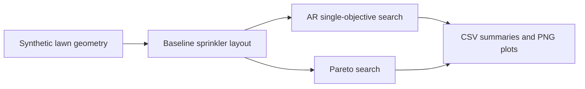

# campOS

**Synthetic irrigation-layout optimization prototype** · Python · Research / simulation prototype

[](https://github.com/HaochuanLin/campOS/actions/workflows/tests.yml)
[](https://www.python.org/)
[](LICENSE)

[English](#english) · [简体中文](#简体中文)

campOS explores sprinkler-layout optimization on **synthetic irregular lawn shapes**. It compares fixed-position retrofits, movable sprinkler layouts, and Pareto trade-offs between overspray and interior water deficit.

> **Research prototype only.** Geometry and physical/economic inputs are synthetic or placeholders. There is no field validation. Outputs are not installation specifications or guaranteed water savings.

## Quick start

Requires Python 3.10 or newer.

```bash
git clone https://github.com/HaochuanLin/campOS.git
cd campOS
python -m pip install -r requirements.txt
python campos_sim.py --help
```

Run a quick smoke test on one synthetic site:

```bash
python campos_sim.py --mode movable --quick --sites A --outdir out/demo
```

Run fixed-position optimization:

```bash
python campos_sim.py --mode fixed --sites A C --outdir out/fixed
```

Explore the overspray/deficit Pareto front:

```bash
python campos_sim.py --mode pareto-fixed --quick --sites C --outdir out/pareto
```

Run all four modes across all five sites (computationally expensive):

```bash
python campos_sim.py --mode all --outdir out/full
```

Generated CSVs and PNGs are written to the chosen output directory. The default is `out/`. `--quick` reduces iteration counts for smoke testing; it is not a substitute for a full run.

## What is modelled?

| Mode | What may change | Main purpose |
|---|---|---|
| `movable` | Sprinkler position, radius and sector angles | Explore a new layout |
| `fixed` | Radius and sector angles; **x/y positions stay fixed** | Explore a retrofit without relocating heads |
| `pareto-movable` | Position, radius and sector angles | Explore overspray/deficit trade-offs |
| `pareto-fixed` | Radius and sector angles; **x/y positions stay fixed** | Explore retrofit trade-offs |

The five built-in sites are generated shapes: **A** rectangle, **B** L-shape, **C** kidney, **D** wedge, and **E** roadside strip.



## Reading the metrics correctly

- **AR-based saving metric is not total-water saving.** It estimates the modelled water required to bring the driest 25% of the lawn to a target depth. Total discharge after optimization can increase.
- **Overspray and interior deficit are separate objectives.** The Pareto search retains non-dominated solutions instead of collapsing both into one reported score.
- The standard-grid + preset-arc baseline already has low overspray (about 0–1%) but reported edge dry patches (5.6–8.1%) in the supplied project summary. That summary did **not** show an overspray reduction against this baseline.
- The “full-circle sprinkler” is a reference scenario only, not a measured existing installation.

## Preliminary figures supplied with the project brief

These figures were supplied in the project brief. The original result CSVs were not available for independent verification in this repository. Treat all figures below as **unverified synthetic-model outputs using placeholder assumptions**, not field measurements.

| Mode | Synthetic shape | AR-based metric | Placeholder payback |
|---|---|---:|---:|
| Fixed position | Kidney | 35.3% | 12.1 years |
| Fixed position | L-shape | 25.5% | 22.6 years |
| Movable | Kidney | 38.0% | 65.5 years |
| Movable | L-shape | 24.0% | 137.1 years |

Reported comparison against the **full-circle reference only**:

| Synthetic shape | Overspray | Interior deficit |
|---|---:|---:|
| Kidney | 21% → 14% | 6.8% → 0.9% |
| Roadside strip | 54% → 11.6% | 6.6% → 1.1% |

No result images are included yet. Do not interpret the figures as verified until the corresponding CSVs and run configuration are published and checked.

## Assumptions and limitations

- Lawn outlines are synthetic; no real-site survey or field validation is included.
- Sprinkler precipitation profile and throw range are placeholders, not manufacturer specifications.
- Water tariff, annual irrigation depth and retrofit costs are placeholders, not verified prices.
- Wind, pressure loss, evaporation, drift, slope and soil are not modelled.
- Simulated water depth uses relative model units, not litres.
- There is no calibrated vendor profile, lifecycle-cost study or operational safety assessment.

Use the output for exploratory comparison only—not construction, irrigation scheduling, procurement, or promised savings.

## Development

Install dependencies and run the regression suite:

```bash
python -m pip install -r requirements.txt
python -m pytest -q
```

The tests check fixed-mode coordinate invariance and that a movable quick run completes and writes its expected files. GitHub Actions runs the test suite on pushes and pull requests.

### Roadmap

- [ ] Add source CSVs, run configuration and verified result figures.
- [ ] Support imported lawn polygons with validation.
- [ ] Add manufacturer precipitation profiles and throw-vs-pressure data.
- [ ] Add wind/pressure sensitivity and uncertainty analysis.
- [ ] Validate against measured sites with permission and a documented protocol.
- [ ] Save seed, configuration and dependency versions with each result.

## License

MIT. See [LICENSE](LICENSE). Confirm code ownership and third-party licensing before redistribution.

---

## 简体中文

campOS 是一个用于探索**合成异形草坪**喷灌布局的 Python 仿真原型，比较固定喷头位置改造、可移动布局，以及溢出与草坪内缺水之间的 Pareto 权衡。

> **仅供研究与探索。** 草坪几何为合成数据，喷头物理参数和经济参数含占位值，未经真实场地验证。输出不是施工方案，也不构成节水保证。

### 快速开始

需要 Python 3.10 或更新版本。

```bash
git clone https://github.com/HaochuanLin/campOS.git
cd campOS
python -m pip install -r requirements.txt
python campos_sim.py --help
python campos_sim.py --mode movable --quick --sites A --outdir out/demo
```

其他常用命令：

```bash
python campos_sim.py --mode fixed --sites A C --outdir out/fixed
python campos_sim.py --mode pareto-fixed --quick --sites C --outdir out/pareto
python campos_sim.py --mode all --outdir out/full
```

生成的 CSV 和 PNG 会写入指定目录，默认是 `out/`。`--quick` 只用于快速冒烟测试，不等于完整优化。

### 模式与场地

| 模式 | 可调整内容 | 用途 |
|---|---|---|
| `movable` | 喷头位置、射程和扇区角 | 探索新布局 |
| `fixed` | 射程和扇区角，**喷头坐标不变** | 探索不移动喷头的改造 |
| `pareto-movable` | 位置、射程和扇区角 | 分析溢出/缺水权衡 |
| `pareto-fixed` | 射程和扇区角，**喷头坐标不变** | 分析固定位置改造方案 |

内置场地均为合成形状：**A** 矩形、**B** L 形、**C** 肾形、**D** 楔形、**E** 路边窄条。

### 如何理解结果

- **AR 口径指标不等于总用水量节省比例。** 它估算模型中让草坪最干的 25% 达到目标水深所需的水量；优化后的总出水量可能增加。
- **溢出与草坪内缺水是不同指标。** Pareto 搜索保留非支配解，不把两者合并成一个最终报告分数。
- 项目简介称，“标准网格 + 预设弧度”基线的溢出约为 0–1%，但边缘干斑约为 5.6–8.1%；因此不能声称相对该基线降低了溢出。
- “全圆喷头”仅是参照场景，不是实测的现有安装布局。

### 项目简介提供的初步数值

以下数字来自项目简介，当前仓库没有原始结果 CSV 可供独立复核。它们是采用占位参数的合成模型结果，**不是实测结果**。

| 模式 | 合成形状 | AR 口径指标 | 占位回收期 |
|---|---|---:|---:|
| 固定位置 | 肾形 | 35.3% | 12.1 年 |
| 固定位置 | L 形 | 25.5% | 22.6 年 |
| 可移动 | 肾形 | 38.0% | 65.5 年 |
| 可移动 | L 形 | 24.0% | 137.1 年 |

相对**全圆喷头参照方案**的项目简介数据：

| 合成形状 | 溢出比例 | 草坪内缺水指标 |
|---|---:|---:|
| 肾形 | 21% → 14% | 6.8% → 0.9% |
| 路边窄条 | 54% → 11.6% | 6.6% → 1.1% |

当前尚未提供结果图。补齐并核验对应 CSV 和运行配置之前，不应将上述数字当作已复现的结果。

### 假设与局限

- 草坪轮廓是合成数据，没有真实场地测绘或实地验证。
- 喷头降水分布和射程为占位参数，不是厂商规格。
- 水价、年灌溉深度和改造成本均为占位值，不是已核实价格。
- 模型未考虑风、压力损失、蒸发、飘移、坡度和土壤。
- 仿真水深为相对单位，不是升。
- 尚无厂商曲线标定、全生命周期成本分析或运行安全评估。

结果仅用于探索性比较，不应用于施工、灌溉排程、采购或节水承诺。

### 测试与开发

```bash
python -m pip install -r requirements.txt
python -m pytest -q
```

测试检查固定模式下喷头坐标不变，以及可移动模式的快速运行能否完成并生成预期文件。GitHub Actions 会在 push 和 pull request 时运行测试。

### 后续计划

- [ ] 添加原始 CSV、运行配置和核验后的结果图。
- [ ] 支持导入草坪多边形并验证输入。
- [ ] 增加厂商降水分布和射程—压力数据。
- [ ] 增加风/压力敏感性及不确定性分析。
- [ ] 在获得许可并记录验证方案后，使用真实场地数据验证。
- [ ] 每次运行保存随机种子、配置和依赖版本。

### 许可证

采用 MIT，详见 [LICENSE](LICENSE)。再分发前请确认代码权属及第三方许可证兼容性。
